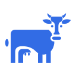
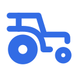

# assets

Logo assets for rocattle. Every logo is a single-color (`#326CE5`) SVG on a transparent background, with PNG renders at 16, 32, 48, 64, 128, 256, 512 and 1024 px.

| Preview | Name | SVG | PNG |
|---------|------|-----|-----|
|  | cow | [cow.svg](logos/cow/cow.svg) | [png/](logos/cow/png) |
|  | cow-head | [cow-head.svg](logos/cow/cow-head.svg) | [png/](logos/cow/png) |
|  | tractor-outline | [tractor-outline.svg](logos/tractor/tractor-outline.svg) | [png/](logos/tractor/png) |

## Usage

```
https://raw.githubusercontent.com/rocattle/assets/main/logos/cow/cow.svg
https://raw.githubusercontent.com/rocattle/assets/main/logos/cow/png/cow-256.png
```

## Rendering

SVG is the source of truth. After editing an SVG, regenerate the PNGs with [librsvg](https://gitlab.gnome.org/GNOME/librsvg):

```bash
./scripts/render.sh
```
