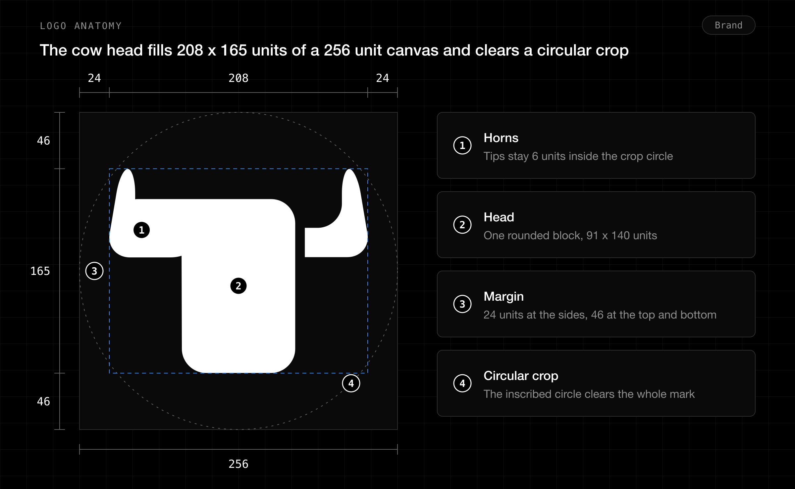

# Cow head

Design system guide for the kattler cow-head mark. It is for anyone placing the mark in a README, a website, an avatar, or a slide.

## Mark

- A front-facing cow head with two horns, drawn as one flat shape
- Single solid fill, no stroke, no gradient, no shadow
- Always used whole. The horns and the head are never separated

## Anatomy

<p align="center"><a href="assets/cow-head-anatomy.svg"></a></p>

- The figure is in canvas units, measured from the rendered mark
- The dashed square is the bounding box of the mark and the dotted circle is a circular crop

## Variants

| Variant | Mark | Background | Source |
| --- | --- | --- | --- |
| Black | White `#FFFFFF` | Black `#000000`, full square | [cow-head-black.svg](cow-head-black.svg) |
| Green | Green `#22C55E` | Transparent | [cow-head-green.svg](cow-head-green.svg) |

- Black is the default for avatars, favicons, and any place that needs a solid tile
- Green is for dark surfaces where the mark sits directly on the page

## Color

- White `#FFFFFF`, RGB 255 255 255
- Black `#000000`, RGB 0 0 0
- Green `#22C55E`, RGB 34 197 94
- Green on black has a contrast ratio of about 9.2:1
- Green on white has a contrast ratio of about 2.3:1, so the green variant is not used on light backgrounds

## Canvas and geometry

- Canvas is a 256 x 256 unit square (`viewBox="0 0 256 256"`)
- The mark is about 208 x 165 units and centered on both axes
- Margin is 24 units on the left and right (9.4% of the canvas) and 46 units on the top and bottom (17.9%)
- The black tile has square corners. The platform applies any rounding
- The horn tips stay about 6 units inside the inscribed circle, so a circular crop does not clip the mark

## Clear space and size

- The margins inside the canvas are the clear space. Place the whole canvas and do not crop into it
- Keep other elements at least 24 canvas units away from the green variant, which equals the side margin
- Minimum size is 16 px. Below 32 px the black variant reads better than the green one
- PNG renders exist at 16, 32, 48, 64, 128, 256, 512, and 1024 px. Pick the render closest to twice the displayed size for high-density screens

## Usage rules

- Scale the mark with a locked aspect ratio
- Use only the two color combinations listed under Variants
- Do not rotate, mirror, outline, or add effects to the mark
- Do not place the green variant on a light, green, or busy photographic background
- Do not edit a PNG by hand. Change the SVG and render again

## Files

```
cow-head-black.svg
cow-head-green.svg
png/cow-head-black-<size>.png
png/cow-head-green-<size>.png
assets/cow-head-anatomy.svg
assets/cow-head-anatomy.png
```

- SVG is the source of truth
- Regenerate the PNGs with `./scripts/render.sh` from the repository root
- The anatomy figure is not covered by the script. Render it at twice its width with `rsvg-convert -w 2400`

## Notes

- The head geometry is taken from the head portion of the Rancher cow mark. Rancher is a trademark of SUSE
- The black PNGs are opaque, unlike the other logos in this repository, which have a transparent background
