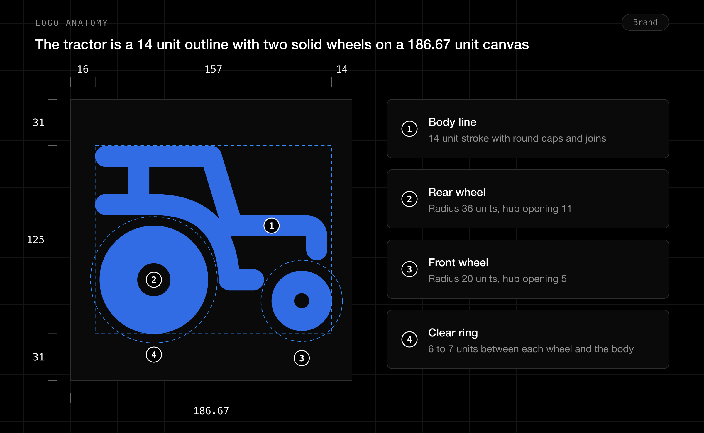

# Tractor

Design system guide for the kattler tractor mark. It is for anyone placing the mark in a README, a website, an avatar, or a slide.

## Mark

- A side view of a tractor facing right, drawn as an outline
- The cab and hood are lines. The two wheels are solid discs with an open hub
- Single color on a transparent background, no gradient, no shadow
- Always used whole. The wheels and the body are never separated

## Anatomy

<p align="center"><a href="assets/tractor-outline-anatomy.svg"></a></p>

- The figure is in canvas units, measured from the rendered mark
- The dashed square is the bounding box of the mark and the dashed circles are the clear rings around the wheels

## Variants

- Outline is the only variant: [tractor-outline.svg](tractor-outline.svg)

## Color

- Blue `#326CE5`, RGB 50 108 229
- Blue on white has a contrast ratio of about 4.8:1
- Blue on black has a contrast ratio of about 4.4:1
- The mark works on both light and dark surfaces. It is not used on blue or mid-tone backgrounds

## Canvas and geometry

- Canvas is a 186.67 unit square (`viewBox="6.67 20.17 186.67 186.67"`)
- The mark is about 157 x 125 units, which is 84% of the canvas width
- Margin is about 16 units on the left, 14 on the right, and 31 on the top and bottom
- The mark reaches about 3 units past the inscribed circle, so a circular crop clips the top left corner of the cab
- Line weight is 14 units, 7.5% of the canvas, with round caps and round joins
- The rear wheel has a radius of 36 units and a hub opening of 11 units
- The front wheel has a radius of 20 units and a hub opening of 5 units
- A gap of 6 to 7 units separates each wheel from the body lines

## Clear space and size

- The margins inside the canvas are the clear space. Place the whole canvas and do not crop into it
- Keep other elements at least 14 canvas units away from the canvas edge, which equals one line weight
- Minimum size is 16 px, where the line is about 1.2 px wide. Prefer 32 px or larger when the hub openings need to stay visible
- PNG renders exist at 16, 32, 48, 64, 128, 256, 512, and 1024 px. Pick the render closest to twice the displayed size for high-density screens

## Usage rules

- Scale the mark with a locked aspect ratio, so the line weight scales with it
- Use only the blue listed under Color
- Do not rotate, mirror, fill the outline, or add effects to the mark
- Do not change the line weight or the wheel gaps on their own
- Do not edit a PNG by hand. Change the SVG and render again

## Files

```
tractor-outline.svg
png/tractor-outline-<size>.png
assets/tractor-outline-anatomy.svg
assets/tractor-outline-anatomy.png
```

- SVG is the source of truth
- Regenerate the PNGs with `./scripts/render.sh` from the repository root
- The anatomy figure is not covered by the script. Render it at twice its width with `rsvg-convert -w 2400`
